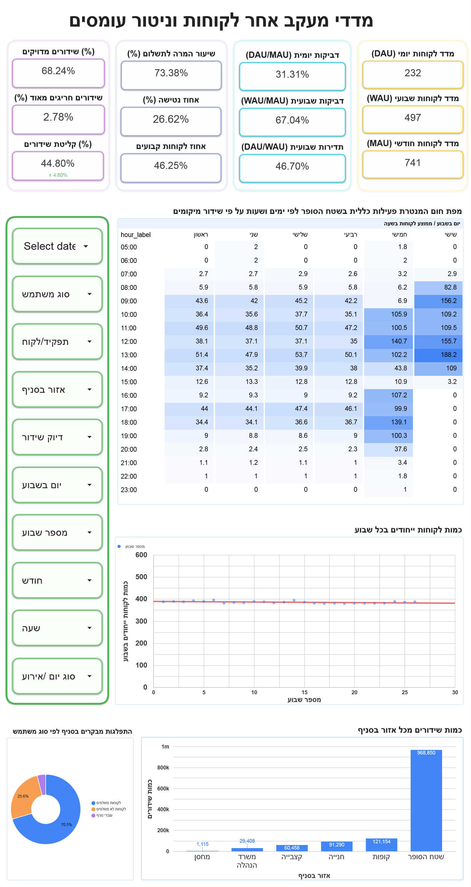
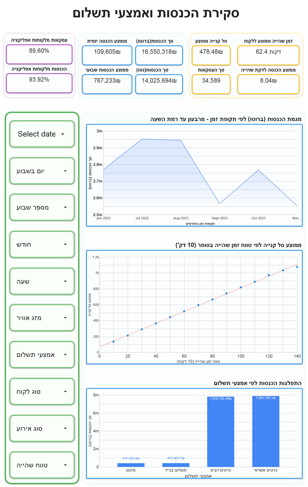
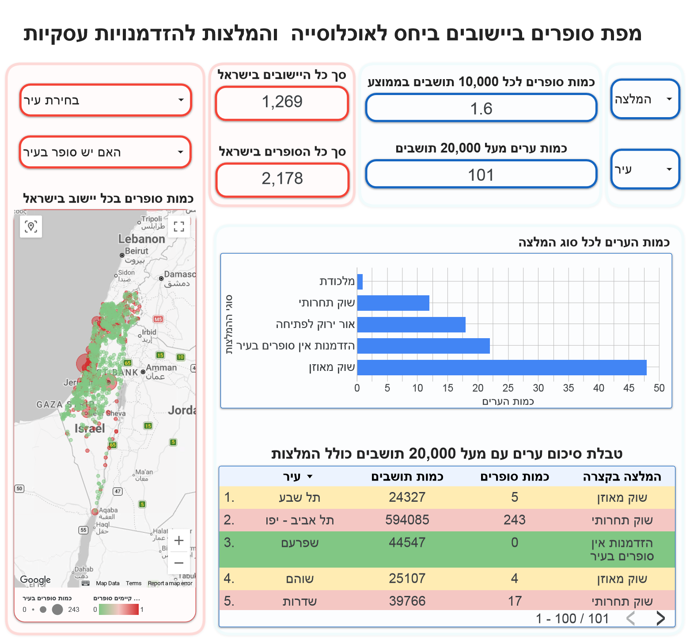

# ניתוח נתונים אסטרטגי ותפעולי: רשת "שפע יששכר" (סניף יבנה) ואפליקציית "שפע בְּכַּפַע"

**מגיש הפרויקט:** אליהו זוזות (`Eliyahu Zuzut`) | `Data Analyst`  
**טכנולוגיות וכלים:** `Google BigQuery (SQL)` • `Python (Pandas, Matplotlib, Seaborn)` • `Looker Studio (BI)` • `Linear Regression`

🔗 **[למעבר לדשבורד האינטראקטיבי החי ב-`Looker Studio` — לחצו כאן](https://datastudio.google.com/reporting/01dc3d26-2869-4ead-87c6-9e16bee5f45d)**  
📄 **[לקריאת הדו"ח המסכם המלא — לחצו כאן](report/PenlinkSolution_Eliyahu_Zuzut_Report.pdf)**  
💻 **[לצפייה בקוד ה-`SQL` המלא ב-`BigQuery` — לחצו כאן](sql/Shefa_Issachar_SQL_Queries_HE.sql)**  
📊 **[לצפייה במצגת המנהלים — לחצו כאן](presentation/Shefa_Issachar_Yavne_Presentation_HE.pdf)**

---

## 1. תקציר הפרויקט והאתגר העסקי
פרויקט אנליטיקה ובינה עסקית מקצה לקצה (`End-to-End`) שנערך עבור סניף יבנה והנהלת רשת המרכולים **"שפע יששכר"**, בעקבות השקת אפליקציית המועדון מבוססת המיקום **"שפע בְּכַּפַע"**.

המחקר מנתח **חצי שנת פעילות מלאה (`01/06/2025` עד `30/11/2025`)** — סך הכל **183 ימים קלנדריים** המתחלקים ל-**151 ימי פעילות** שבהם הסניף היה פתוח לקהל ול-**32 ימי סגירה** (26 ימי שבת ו-6 חגים רשמיים באמצע השבוע: שבועות, א' וב' דראש השנה, יום הכיפורים, סוכות ושמחת תורה).

### מטרות המחקר המרכזיות:
1. **אפיון התנהגות צרכנים וסלי קנייה:** סגמנטציה התנהגותית של לקוחות הסניף וזיהוי מנועי ההכנסה המרכזיים.
2. **ייעול תפעולי ובקרת איכות:** אימות אמינות אותות ה-`GPS`, בניית מודל כמותי לשיבוץ משמרות קופאים, בקרת שעות שכר וניטור שרשרת האספקה.
3. **העשרת נתונים חיצונית (`Data Enrichment`):** הצלבת נתוני הקופות והמיקומים מול לוח השנה העברי, חגים, אירועים ביטחוניים ותנאי מזג אוויר יומיים ביבנה.
4. **אסטרטגיית התרחבות ארצית:** פיתוח מודל דירוג ל-101 ערים בישראל (מעל 20,000 תושבים) לאיתור הזדמנויות לפתיחת סניפים חדשים.

---

## 2. ארכיטקטורת הנתונים ב-`Google BigQuery`

| שם הטבלה | היקף רשומות | תפקיד הטבלה במחקר |
| :--- | :--- | :--- |
| `geolocation` | **1,308,624** | אותות מיקום (`GPS Pings`) בדגימה של ~`40%` לדקה מ-**1,080 מכשירים ייחודיים** ב-6 אזורי הסניף (`SUPERMARKET`, `CASH_REGISTERS`, `PARKING`, `BUTCHERY`, `HEAD_OFFICE`, `WAREHOUSE`) |
| `log_sales` | **34,589** | תיעוד עסקאות ששולמו בקופות בסך הכנסות ברוטו כולל של **16,550,318 ₪** (סל קנייה ממוצע: **478.48 ₪**) |
| `Lamas_Israel_2026` | **1,269 יישובים** | נתוני אוכלוסייה והתפלגות גילאים ביישובי ישראל מתוך הלמ"ס (ספטמבר 2025) |
| `supermarkets_il` | **2,178 סניפים** | מיפוי ארצי של מרכולים, סופרמרקטים ומינימרקטים בישראל מתוך `OpenStreetMap` ב-333 יישובים |
| `calendar_il_bigquery` | **183 ימים** | **טבלת העשרה חיצונית שנבנתה עבור המחקר:** לוח שנה עברי, חגים וערבי חג, חופשות, ימי "מבצע עם כלביא" ונתוני טמפרטורה וגשם יומיים ביבנה |

---

## 3. ממצאים מרכזיים והמלצות אסטרטגיות להנהלה

### א. סגמנטציית לקוחות ותקרת הצמיחה השבועית
- מתוך 1,037 משתמשי אפליקציה, קבוצת **הלקוחות החוזרים (`repeat_customer`, 352 מכשירים)** אחראית ל-**91.87% מכלל הפדיון** (15.20 מיליון ₪ מתוך 30,083 עסקאות, סל ממוצע של **505.43 ₪** ושהייה ממוצעת של **62.9 דקות**).
- לצדם זוהו **409 לקוחות מזדמנים** (2.05% מההכנסות, סל ממוצע 373.47 ₪), **276 מבקרים לא משלמים** (`not_paying`), ו-**3,596 עסקאות של לקוחות ללא אפליקציה** (`no_phone`, 6.08% מההכנסות, סל ממוצע 279.66 ₪).
- **המלצה:** מאחר שמספר הלקוחות השבועי קבוע סביב **~386 לקוחות ייחודיים בשבוע** ללא צמיחה אורגנית, יש להשיק הטבת הצטרפות בקופות להמרת רוכשי ה-`no_phone` והלקוחות המזדמנים לחברי מועדון קבועים.

### ב. הערך הכלכלי של זמן השהייה ו"החמצת הקצבייה"
- **כל דקת שהייה נוספת בסניף מגדילה את סל הקנייה ב-7.41 ₪ בממוצע** (`74.13 ₪` לכל 10 דקות).
- מניתוח אזורי ה-`GPS` התגלה כי מתקבלים **0 אותות של לקוחות באזור הקצבייה (`BUTCHERY`)** למרות נוכחות רציפה של 4 קצבים קבועים!
- **המלצה:** שיגור התראות `Push` מבוססות מיקום עם מבצעים ייעודיים לקצבייה ולמאפייה (הממוקמות בעומק הסניף) להארכת מסלול הקנייה והגדלת הפדיון.

### ג. אופטימיזציית משמרות קופאים והצבת עמדות שירות עצמי
- חישוב קיבולת השירות בקופה (3.66 דקות ברוטו ללקוח אפליקציה ו-2.04 דקות ללקוח ללא אפליקציה, כולל מרווח ביטחון של 20%) גוזר תקן של **17 לקוחות לשעה לקופאי**.
- בשעות הצהריים השקטות (`12:00–16:00`, וביחוד `15:00–16:00` שבהן נרשמת כ-1.4 עסקאות בשעה בלבד) קיים עודף של עד 3.5 קופאים, בעוד שבשיא יום שישי (`14:00`, דרישה ל-7 קופאים מול 4.4 בפועל) ובערבי חמישי נוצר **צוואר בקבוק חריף**.
- **המלצה:** ניוד משמרות מהצהריים לשעות הערב וליום שישי, והצבת **4 עמדות קופה עצמית (`Self-Checkout`)** לספיגת סלי ההשלמה הקטנים (מזומן ותשלום בנייד המוגבלים עד 300 ₪).

### ד. בקרת שרשרת אספקה, מזג אוויר ובקרת שכר
- **כשלי אספקה:** זוהו **3 ימי חמישי פתוחים** (`26/06`, `07/08` ו-`27/11/2025`) שבהם לא הגיע אף ספק למחסן בבוקר — מומלץ להטמיע התראה אוטומטית ב-`06:30` בבוקר ותיאום מראש לפני תאריכים מיוחדים.
- **מבצעי ימי שפל:** יום רביעי מציג את הפדיון הנמוך בשבוע (**52,947 ₪**) ויום שני את מיעוט העסקאות (**143 ביום**) — הומלץ על תוכנית **"רביעי חיסול סחורה"** לקראת פריקת חמישי ו**"שני טרי"** לאחר פריקת שני בבוקר.
- **מזג אוויר ואירועים:** בימי סערה נרשמת צניחה של **15.0%- בעסקאות** ו-**11.9%- בהכנסות**, מול עלייה של **4.1%+ בעסקאות** בימי שרב. יום השיא של החציון (`13/06/2025`, פדיון של **210,165 ₪**) פוענח באמצעות טבלת לוח השנה כיום פרוץ **"מבצע עם כלביא"** והסתערות להצטיידות חירום לממ"דים.
- **בקרת שכר:** ב-6 ימי החג הסגורים נרשמו 0 אותות עובדים (תשלום דמי חג בלבד), אך ב-**5 ערבי חג באמצע השבוע** תועדו עסקאות עד `19:38` ואותות עובדים עד `22:00` — הועברה המלצת בדיקה לחשב השכר טרם אישור שעות נוספות.

---

## 4. סיכום המודלים הסטטיסטיים (`Linear Regression`)

| פרמטר המודל | רגרסיה 1: לקוחות ייחודיים לשבוע (`Y`) מול שבוע (`X`) | רגרסיה 2: סל קנייה ממוצע (`Y`) מול טווח שהייה (`X`) |
| :--- | :--- | :--- |
| **גודל מדגם** | 26 שבועות פעילות מלאים | 15 קבוצות שהייה (בקפיצות של 10 דקות: `0–9` עד `140–149`) |
| **משוואת הישר** | `Y = -0.2451 * X + 388.96` | `Y = 7.4134 * X + 70.02` |
| **מקדם פירסון (`r`)** | `-0.4288` (קשר חלש מאוד) | `0.9995` (מתאם חיובי מושלם כמעט לחלוטין) |
| **איכות ההתאמה (`R²`)** | **`0.1839`** (הזמן מסביר 18.4% בלבד מהשונות) | **`0.9991`** (משך השהייה מסביר 99.91% מהשונות בסל) |
| **מובהקות (`P-value`)** | `0.0288` (מובהק טכנית בשל טווח צר `381–395`, אך הקו שטוח סביב ~386) | `0.0000` (מובהקות סטטיסטית מלאה) |
| **מסקנה עסקית** | הסניף הגיע ל**תקרת מיצוי אורגנית** ונדרש גיוס לקוחות חדשים לאפליקציה | **כל הארכת שהייה** באזורי המכירה מתורגמת ישירות להגדלת הסל |

---

## 5. מערכת ה-`BI` האינטראקטיבית ב-`Looker Studio` (שלושה מסכי בקרה)

🔗 **[כניסה לדשבורד החי והאינטראקטיבי ב-`Looker Studio`](https://datastudio.google.com/reporting/01dc3d26-2869-4ead-87c6-9e16bee5f45d)** *(פתוח לצפייה וסינון דינמי)*

### מסך 1: מדדי מעקב אחר לקוחות וניטור עומסים ([גרסת `PDF`](dashboard/Screen1_Customer_Tracking_HE.pdf))
כולל 12 כרטיסיות `KPIs` (`DAU`, `WAU`, `MAU`, יחסי דביקות `DAU/MAU` ו-`WAU/MAU`, המרה לתשלום, נטישה ואיכות קליטת `GPS`), 10 מסננים אינטראקטיביים, מפת חום שעתית-שבועית, מגמת לקוחות שבועית והתפלגות אזורים בסניף:

### מסך 2: סקירת הכנסות ואמצעי תשלום ([גרסת `PDF`](dashboard/Screen2_Revenue_Overview_HE.pdf))
כולל 10 כרטיסיות `KPIs` (הכנסות ברוטו ונטו, סל ממוצע, הכנסה לדקת שהייה ומשקל לקוחות האפליקציה), מגמת הכנסות עם תחקור `Drill-Down` מרבעון ועד רמת השעה, רגרסיית שהייה מול סל והתפלגות אמצעי תשלום:

### מסך 3: מפת תחרות ואסטרטגיית התרחבות ארצית ([גרסת `PDF`](dashboard/Screen3_Expansion_Map_HE.pdf))
מציג מיפוי גיאוגרפי של 1,269 יישובים ו-2,178 סופרים בישראל, ודירוג דינמי של 101 הערים מעל 20,000 תושבים (22 ערי הזדמנות ללא סופר ממופה, 18 ערי "אור ירוק לפתיחה", 48 שווקים מאוזנים, 12 שווקים רוויים ועיר "מלכודת" תחרות אחת):

---

## 6. מבנה המאגר וניווט מהיר לקבצים

| נתיב במאגר | תיאור הקובץ |
| :--- | :--- |
| [`Project_Guidelines_HE.md`](Project_Guidelines_HE.md) | מסמך אפיון הפרויקט המאוחד: סיפור המסגרת, תיאור הטבלאות, שאלות המחקר והנחיות משימת ה-`Python` |
| [`report/PenlinkSolution_Eliyahu_Zuzut_Report.pdf`](report/PenlinkSolution_Eliyahu_Zuzut_Report.pdf) | הדו"ח המסכם המלא (11 עמודים בפורמט `PDF` + קובץ מקור [`DOCX`](report/PenlinkSolution_Eliyahu_Zuzut_Report.docx)) |
| [`sql/Shefa_Issachar_SQL_Queries_HE.sql`](sql/Shefa_Issachar_SQL_Queries_HE.sql) | קובץ ה-`SQL` המלא ל-`BigQuery` (כל השאילתות, כולל סיווג התנהגותי, בקרת חריגים, שיבוץ משמרות, שכר וייבוא לדשבורד) |
| [`notebooks/Python_solution_Eliyahu_Zuzut.ipynb`](notebooks/Python_solution_Eliyahu_Zuzut.ipynb) | מחברת ה-`Python` (`Jupyter Notebook`): חיבור ל-`BigQuery`, ניתוח שעות פעילות ופונקציית בדיקת קליטת `GPS` |
| [`data/calendar_il_bigquer.csv`](data/calendar_il_bigquer.csv) | טבלת העשרת הנתונים החיצונית (183 ימים: תאריך עברי, חגים, אירועים, טמפרטורה ומשקעים ביבנה) |
| [`presentation/Shefa_Issachar_Yavne_Presentation_HE.pdf`](presentation/Shefa_Issachar_Yavne_Presentation_HE.pdf) | מצגת המנהלים בת 8 שקפים בפורמט `PDF` (ולצידה קובץ המקור ב-[`PPTX`](presentation/Shefa_Issachar_Yavne_Presentation_HE.pptx)) |
| [`dashboard/`](dashboard/) | קובצי ה-`PDF` ותמונות התצוגה של שלושת מסכי הדשבורד ב-`Looker Studio` |

